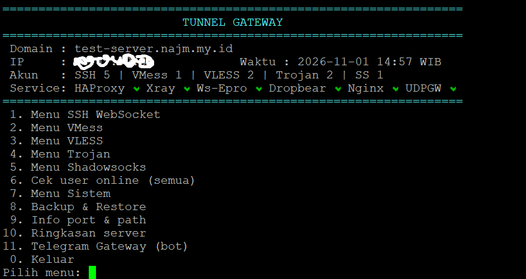

# 🚀 Tunnel Gateway — Ansible

Script gratis dan otomatis untuk menginstal VPN Gateway di server Anda. Dikelola sepenuhnya melalui antarmuka CLI yang ringan dan interaktif, tanpa menggunakan panel web yang memakan banyak resource.



## ✨ Fitur Utama

* **Penegakan Otomatis:** Limit IP/Login bersamaan & Limit Kuota Bandwidth.

* **Trial Akun:** Pembuatan akun uji coba yang otomatis terhapus saat kedaluwarsa.

* **Keamanan:** Banned/Lock otomatis untuk pengguna yang melanggar batasan.

* **Notifikasi:** Terintegrasi dengan Bot Telegram (opsional).

* **Aman & Fleksibel:** Fitur Backup & Restore database akun ke file terenkripsi.

* **Manajemen Mudah:** CLI interaktif (`menu`) atau perintah langsung (`tunnelctl`).

## 🛡️ Protokol yang Didukung

* SSH WebSocket (WS)

* SSH Stunnel (TLS)

* Xray VMess

* Xray VLESS

* Xray Trojan

* Xray Shadowsocks

## 🖥️ Dukungan Sistem Operasi

Hanya OS berikut (amd64/arm64), dengan **langkah instalasi yang sama**:

| OS | Status |
|---|---|
| Ubuntu 22.04 | ✅ Teruji penuh (server produksi) |
| Ubuntu 24.04 | Teruji sebagian (paket, classifier HAProxy 2.8) |
| Ubuntu 26.04 | Belum diuji di server nyata |
| Debian 12 | Belum diuji di server nyata |
| Debian 13 | Belum diuji di server nyata |

Perbedaan antar-OS ditangani otomatis: Python 3.12 terpisah untuk Ansible bila Python OS lebih lama
(Ubuntu 22.04, Debian 12), sintaks HTTP/2 Nginx, dan manifest versi paket per OS.

## ⚙️ Instalasi (sama untuk semua OS)

Syarat: server bersih, login `root`, port **22, 80, 443** terbuka di firewall/security group provider.

```bash
apt-get update && apt-get install -y git tmux
tmux new -s install                 # proses aman walau SSH terputus
git clone https://github.com/ica4me/tunnel-gateway.git /root/tunnel-gateway
cd /root/tunnel-gateway
bash bootstrap.sh                   # inventories/new-server/hosts.yml
```

`bootstrap.sh` menjalankan 5 tahap: paket OS → Speedtest (opsional) → rollback firewall → konfigurasi
service → verifikasi. Saat diminta, pilih mode paket **1 (pinned)**.

Sebelum menjalankan, cek `inventories/new-server/hosts.yml`:

- `ssh_admin_port` = port SSH yang sedang Anda pakai; port SSH lain masukkan ke `ssh_admin_extra_ports`.
- `tunnel_domain` **boleh dikosongkan**: server memakai IP publik + sertifikat selfsigned.

Tanpa pertanyaan: `PACKAGE_MODE=pinned bash bootstrap.sh` · tanpa Speedtest: `SPEEDTEST=0 bash bootstrap.sh`.
Update/perbaikan: jalankan ulang `bash bootstrap.sh` (aman diulang).

### 🌐 Domain & sertifikat (setelah instalasi)

1. Buat A record domain → IP server di Cloudflare (**DNS only**, awan abu-abu).
2. `menu` → **7 Menu Sistem** → **4 Domain & Sertifikat TLS** → isi domain & email.

Sertifikat Let's Encrypt diterbitkan otomatis dan diperpanjang otomatis. Jika gagal, setelan lama
dipulihkan otomatis.

## 🛠️ Manajemen Server & Akun

```bash
menu                                   # menu interaktif
tunnelctl doctor --json                # cek kesehatan
tunnelctl account create --proto vless --user pelanggan --days 30 --quota 10G --limit 2
tunnelctl account list
tunnelctl backup create
```

## 📄 Lisensi

Kode proyek ini (playbook, role, `tunnelctl`) dirilis di bawah **WTFPL v2.0**. Komponen pihak ketiga
memakai lisensinya masing-masing; Ws-Epro belum memiliki lisensi yang jelas. Lihat
[docs/LICENSING.md](docs/LICENSING.md).
